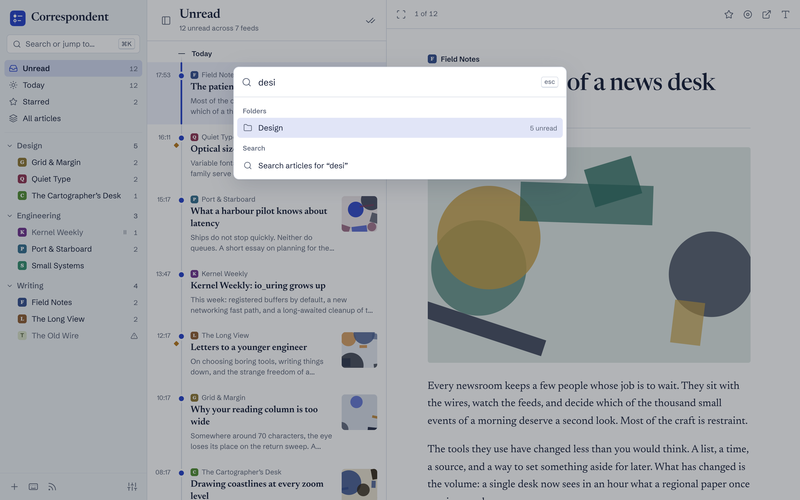
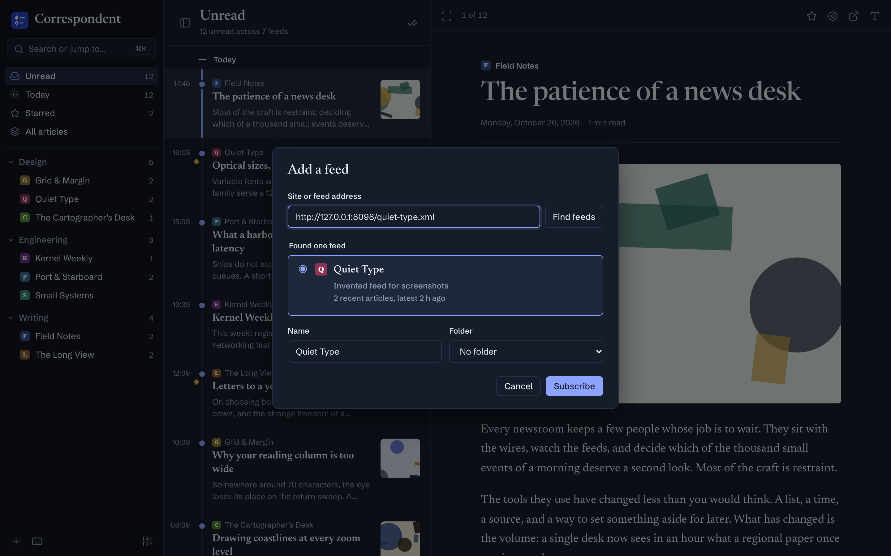
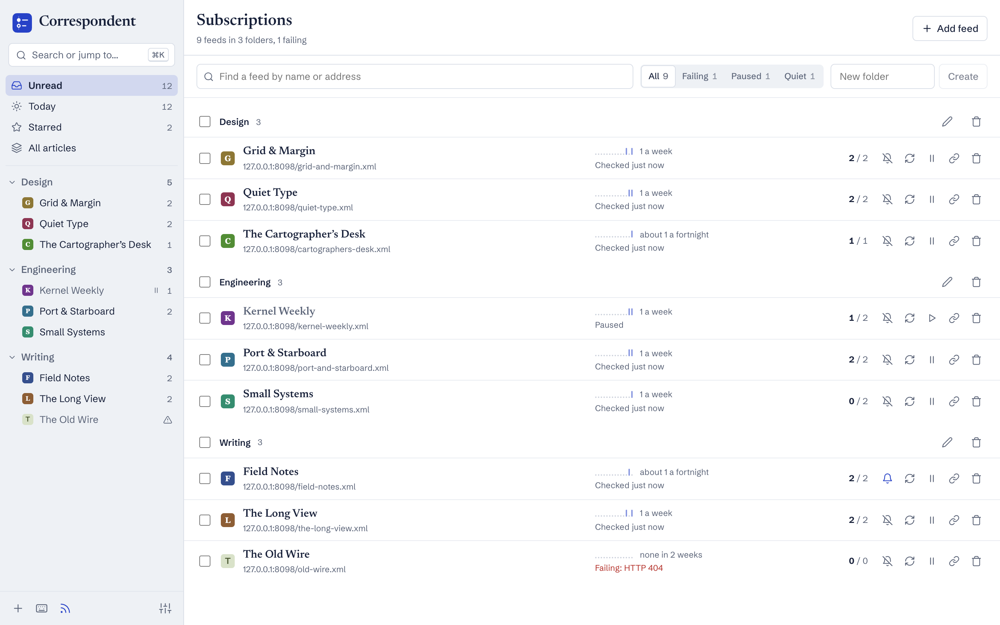
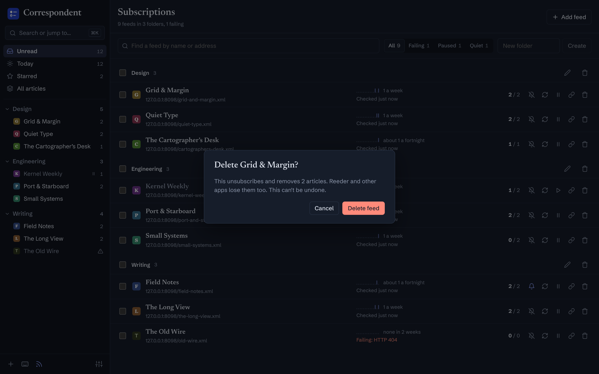
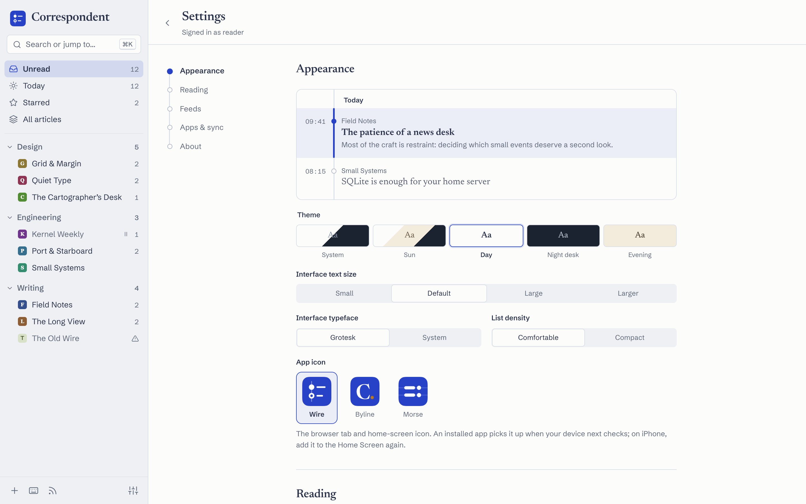
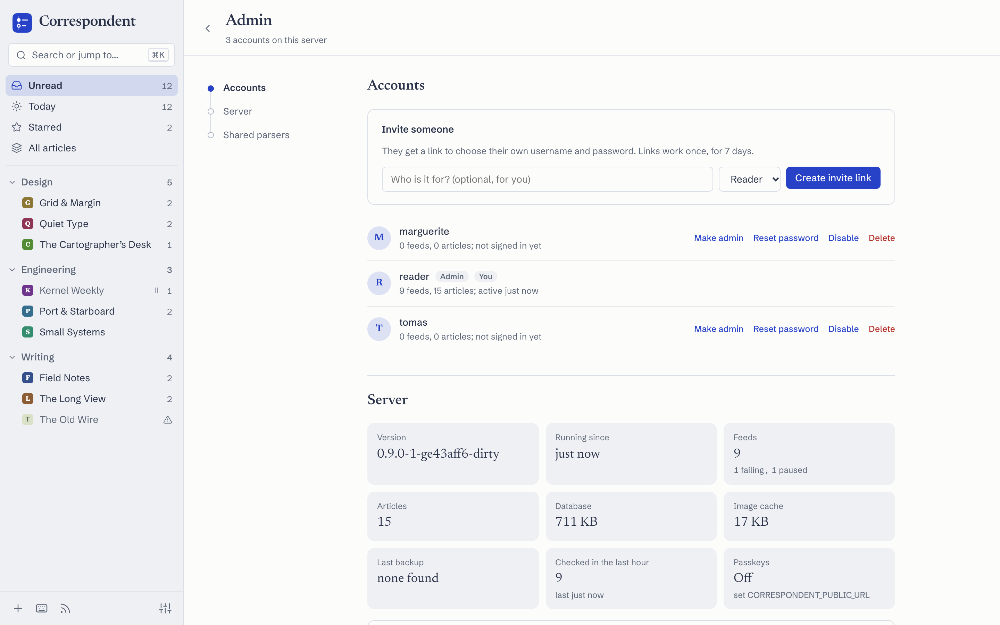
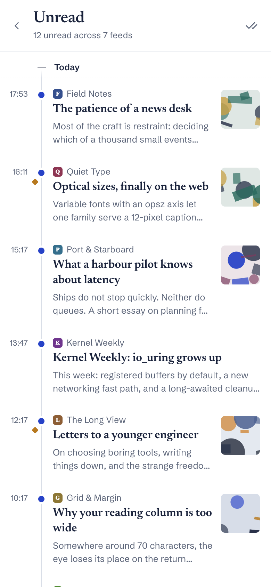
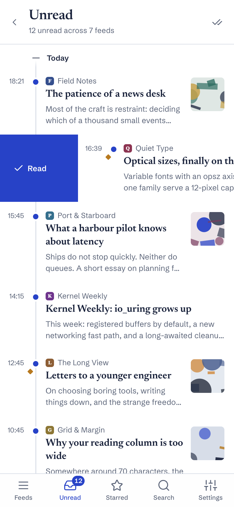
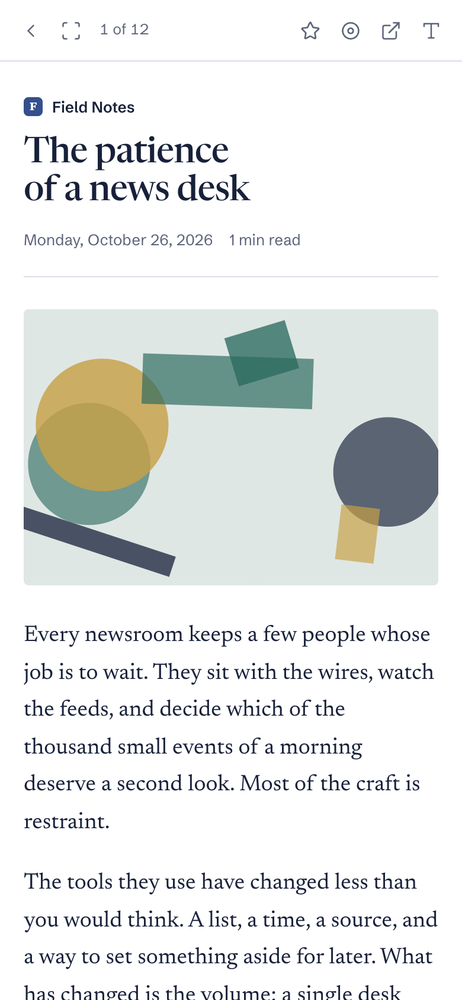
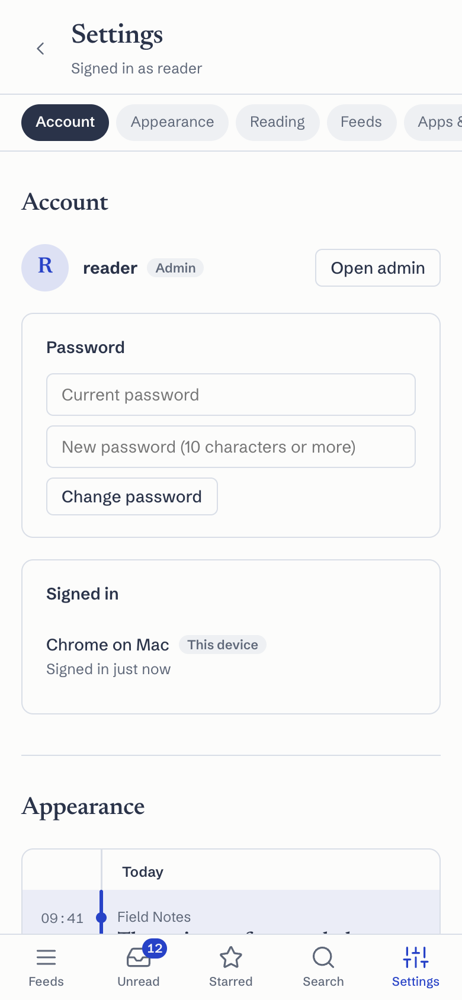

# Correspondent

A self-hosted feed reader with a calm, keyboard-first reading experience, and
a drop-in replacement for FreshRSS as far as Reeder and other Google Reader
clients are concerned.

- **The wire.** Articles hang off a time spine: a filled dot is unread, a ring
  is read, a gold seal is starred. Three themes (Day, Night desk, Evening),
  Newsreader for reading, Schibsted Grotesk for the interface.
- **Reeder-compatible.** `/api/greader.php` serves the Google Reader API with
  FreshRSS's identifiers and timestamps, so an existing Reeder account keeps
  working after cutover.
- **One binary, one container.** Go service with an embedded Svelte 5 UI and
  SQLite, shipped as a 27 MB signed, distroless image.
- **Follows the sun.** The Sun theme turns to Evening an hour before sunset
  where you are and to Night desk 45 minutes after it, computed on your
  device from a location rounded to about 11 km.
- **Swipe on phones.** Swipe right to mark read, left to star.
- **Works offline.** Install it as an app; unread and starred articles are
  kept on the device, and changes made offline sync when you reconnect.
- **Full articles.** For feeds that publish only titles or summaries, fetch
  the article from its page, per article or for every new one in a feed;
  new feeds that turn out to be summaries switch on by themselves.
- **Sites without feeds.** Add a page that lists articles (a lab's research
  page, a company blog) and Correspondent reads it like a feed. It finds the
  articles exactly where it can (microformats, structured data, link
  patterns); otherwise your own AI (Anthropic, or any OpenAI-compatible
  service) writes a parser for the page, once. Parsers are shared by everyone
  on the server and ship built in for popular AI labs; checking for new
  articles never uses AI, and the model only ever returns CSS selectors,
  which are checked against the page before use. Works from Reeder too.
- **Search everything you've read.** Search finds articles by their text,
  not only titles: results appear as you type in the search box (`⌘K`, `/`
  or the Search tab), and work offline for articles kept on the device.
  Save a search to keep it in the sidebar like a folder, with its own
  unread count.
- **Summaries when you want one.** `Shift+S` (or the summary button) shows a
  two-or-three-sentence summary, written by your own AI only when you ask,
  and shared: once anyone has had an article summarized, everyone with it
  can read the summary without using their AI.
- **Notifications you choose.** Off by default; turn them on per device and
  pick feeds with the bell.
- **Live across devices.** Read something in Reeder and it updates in the
  web reader within a second.


| Night desk | Evening, focused reading |
|---|---|
|  |  |
| **Jump anywhere with ⌘K** | **Add a feed from a site or feed address** |
|  |  |
| **Manage subscriptions** | **Deleting asks first** |
|  |  |
| **Settings, with live previews** | **Admin: accounts, server, shared parsers** |
|  |  |

<p>
  
  
  
  
</p>

Screenshots use invented feeds and are regenerated with `make screenshots`.

## Run with Docker

```sh
mkdir -p secrets
openssl rand -base64 24 > secrets/password       # web sign-in
openssl rand -base64 24 > secrets/api_password   # Reeder and other apps
docker compose up -d
```

The image (`ghcr.io/arenzana/correspondent`, amd64 and arm64) is distroless,
runs as a non-root user, works with a read-only root filesystem, and is
signed with cosign:

```sh
cosign verify ghcr.io/arenzana/correspondent:latest \
  --certificate-identity-regexp 'https://github.com/arenzana/correspondent/' \
  --certificate-oidc-issuer https://token.actions.githubusercontent.com
```

The first start creates the account named by `CORRESPONDENT_USER` from the
secret files; passwords are only ever read from files. Put it behind a
TLS-terminating proxy and set `CORRESPONDENT_TRUSTED_PROXIES` to the proxy's
range. Useful commands inside the container:

The data directory also holds `keyring`, the key that encrypts readers' AI
API keys, and `imgcache/`. Keep both out of backups: without the keyring a
backup holds no usable API key (readers enter theirs again after a
restore), and the image cache refills itself.

```sh
docker compose exec correspondent /correspondent backup /data/backup-$(date +%F).db
docker compose exec correspondent /correspondent version
```

| Variable | Default | Purpose |
|---|---|---|
| `CORRESPONDENT_ADDR` | `:8080` | Listen address |
| `CORRESPONDENT_DATA` | `/data` | SQLite directory (local disk, not NFS) |
| `CORRESPONDENT_USER` | | Account to create on first start |
| `CORRESPONDENT_PASSWORD_FILE` | | Web password file for that account |
| `CORRESPONDENT_API_PASSWORD_FILE` | | App (Reeder) password file |
| `CORRESPONDENT_TRUSTED_PROXIES` | | CIDRs whose `X-Forwarded-For` is trusted |
| `CORRESPONDENT_RETENTION_DAYS` | `0` (keep all) | Delete read, unstarred articles older than this that have left their feed |
| `CORRESPONDENT_NO_POLL` | | `1` to serve without fetching feeds (used during migration) |
| `CORRESPONDENT_IMAGE_CACHE_MB` | `512` | Disk for proxied images; `0` turns the image proxy off and images load straight from their sites |
| `CORRESPONDENT_PUBLIC_URL` | | The https address readers use; turns on passkeys (they're bound to it) and appears in invitation links |
| `CORRESPONDENT_INTEGRATIONS_ALLOW` | | Comma-separated CIDRs of your own networks that readers' integrations may reach, such as a tailnet's `100.64.0.0/10`, for a Wallabag or Linkding there; also allows `http://` addresses. Feeds stay blocked from private networks |
| `CORRESPONDENT_INSECURE_COOKIES` | | `1` to allow plain HTTP (development only) |

## Build from source

```sh
make build                                   # UI + Go binary in bin/
./bin/correspondent user add <name>          # reads the password from stdin
./bin/correspondent user api-password <name> # separate password for Reeder
./bin/correspondent serve -addr :8080 -data ./data
```

Session cookies are `Secure` by default, so serve it over HTTPS (or on
localhost). Pass `-insecure-cookies` only for plain-HTTP development.
Behind a reverse proxy, pass `-trusted-proxies 10.42.0.0/16` (your ingress
range) so sign-in throttling sees real client addresses.

## From the terminal, and for AI tools

`corr` is a terminal reader and manager (`brew install arenzana/tap/corr`, or from its pacman repository on Arch and Omarchy; see [docs/cli.md](docs/cli.md)).
Run it alone for a full-screen reader in your web theme; every command also
speaks JSON with stable fields and meaningful exit codes, for scripts and
agents.

```sh
corr auth login --server https://rss.example.org
corr list --view unread --json | jq -r '.entries[].title'
corr subscribe anthropic.com/research
```

AI tools connect to the server itself over MCP at `/mcp`, with a personal
token from Settings → Account (read-only tokens can't change anything):

```sh
claude mcp add --transport http correspondent https://rss.example.org/mcp \
  --header "Authorization: Bearer corr_…"
```

All commands, the JSON shapes and the MCP tools: [docs/cli.md](docs/cli.md).

## Several readers

The first account is the admin. Invite others from **Admin** (in Settings,
or ⌘K): each invitation is a one-time link, valid for a week, where the
person chooses their own username and password; a password reset is a
one-time link too, so passwords never pass through the admin. Each reader
has their own feeds, folders, read state, settings, Reeder password and AI
key; parsers for sites without feeds, summaries, read-aloud audio and the
image cache are shared.

The admin can make others admins, disable an account (it is signed out
everywhere at once, Reeder included, and its feeds stop updating; its data
is kept), delete one with all its data, see the server's health, and test,
rebuild or remove shared parsers. The last admin can't be removed.

Readers can add passkeys in Settings → Account and sign in with Face ID or
Touch ID (set `CORRESPONDENT_PUBLIC_URL`), change their password, and sign
out other devices. From the command line:

```sh
docker compose exec correspondent /correspondent invite [-admin] [-public-url https://rss.example.org]
docker compose exec correspondent /correspondent user role <username> admin
```

## Migrating from FreshRSS

Move a FreshRSS account without touching Reeder: same feed and article IDs,
same passwords, the token FreshRSS issued keeps working, no duplicates, and a
tested way back. See [docs/migration.md](docs/migration.md).

```sh
correspondent migrate import reader -export reader.sqlite -system-config config.php -user-config users/reader/config.php
correspondent migrate verify reader -freshrss https://old.example/api/greader.php -correspondent https://new.example/api/greader.php -api-password-file pw
correspondent migrate rollback reader -freshrss https://old.example/api/greader.php -api-password-file pw -apply
```

`make rehearse` runs the whole cutover against a real FreshRSS in Docker.

## Development

```sh
make dev     # Go on :8080, Vite with hot reload on :5173
make test    # gofmt, vet, Go race tests with coverage, UI unit tests (Vitest)
make e2e     # the offline PWA, end to end in Chrome
make image   # local Docker image
make fuzz    # fuzz the sanitizer and feed parser
make vuln    # govulncheck + npm audit
```

## Listen to articles

Any article can be read aloud in a natural voice (English), with your own
text-to-speech key: OpenAI or a compatible service, ElevenLabs, or
Deepgram (Settings → AI). Press `l` or the headphones in an article;
it keeps playing while you browse, with lock-screen controls on phones.

Audio is made once and shared: when anyone on the server has had an
article read aloud, everyone who follows it can listen, without a key.
Reeder plays it too, as the article's audio, through a private link (set
`CORRESPONDENT_PUBLIC_URL`). `corr listen ID` plays it in the terminal.
Up to 60 new articles a day per reader.

Press `Shift+L` (or the headphones above a list) to listen to its unread
articles that already have audio, one after another; each counts as read
when it ends. Audio is only ever made for an article you pick. Audio for
what you're listening to and the newest unread and starred articles is kept
on the device, so it plays offline (Settings → This device).

## Send to other services

Any article can be sent to a read-later service (Readwise Reader,
Instapaper, Raindrop.io), your own Wallabag, Linkding or Karakeep, or a
webhook: `b` or the send button in an article, or `corr send`. Readers
connect their services in Settings → Integrations; the credentials are
checked with the service, stored encrypted, and only a signed-in browser
can add or change them. The server sends each article and tries again,
with growing waits, while the service is down. Each service can also get
every article its reader stars, from any app, Reeder included.

A webhook gets each article as JSON (title, link, author, feed, summary,
HTML and Markdown), signed in `Correspondent-Signature: t=<unix>,v1=<hex>`:
an HMAC-SHA256, with the key shown when the webhook is added, of
`"<t>.<body>"`.

Obsidian works on the device: set the vault in Settings, and Send to →
Obsidian makes a Markdown note of the article, with its title, source,
author and dates as properties.

## Layout

| Path | Responsibility |
|---|---|
| `internal/fetch` | The only network path: SSRF-safe dialer, size limits, conditional GET |
| `internal/feed`, `internal/content` | Feed normalization, HTML sanitization (bluemonday, applied last) |
| `internal/store` | SQLite schema, hand-written SQL, crawl-time entry IDs, mutation journal |
| `internal/ingest` | Polling scheduler, backoff, discovery, retention |
| `internal/api` | `/api/v1` for the web UI |
| `internal/greader` | Google Reader facade for Reeder |
| `internal/migrate` | FreshRSS import preserving legacy IDs |
| `ui/` | Svelte 5 reader |

## Versions

Correspondent follows [Semantic Versioning](https://semver.org/); changes
are listed in [CHANGELOG.md](CHANGELOG.md). The running version shows in
Settings and from `correspondent version`. To release: add a section to the
changelog, `make release VERSION=x.y.z`, then push the tag; CI publishes the
signed images (`x.y.z`, `x.y`, `latest`) and the GitHub release.

## License

MIT. See [LICENSE](LICENSE).
