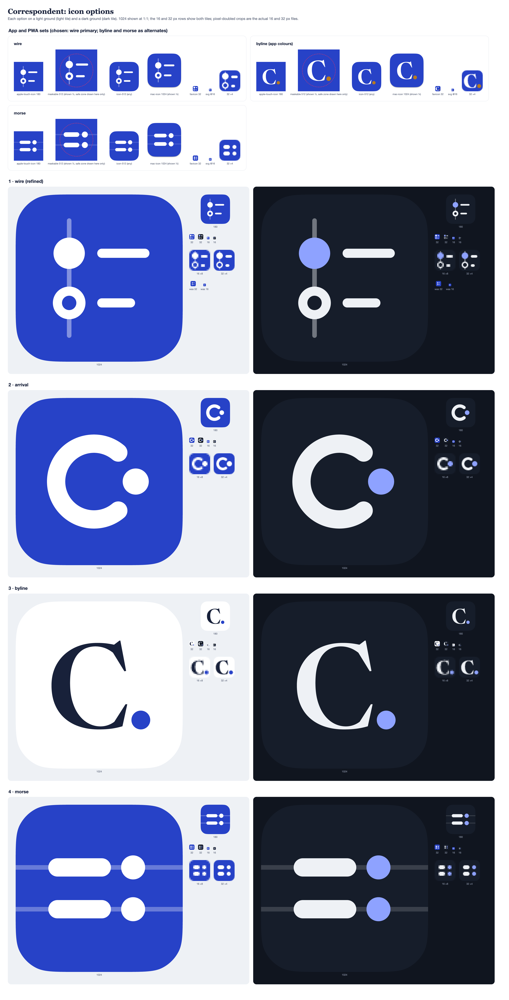

# Correspondent brand: icon options

Every option is drawn in VectorCraft through its MCP server (`vectorcraft-cli mcp --headless`), the same route as memtale's `brand/`. Sources live in `source/<option>-<light|dark>.vectorcraft`, and the pixel-fitted 16 px designs live in `source/<option>-small-<light|dark>.vectorcraft`. VectorCraft writes the exports to `exports/<option>/`: `<option>-<theme>.svg` plus PNGs at 180, 512 and 1024 from the full design, and `<option>-<theme>-small.svg` plus PNGs at 16 and 32 from the small design. To rebuild, run `python3 source/build.py [option…]` and then `node source/sheet.mjs` for `options.png`. Tiles are a continuous-curvature squircle (corner radius 22.37 % of the side, 60 % corner smoothing, as on iOS and macOS). Geometry sits on the old favicon's 64-unit grid, so 1 unit is 16 pt at 1024.

**1 · wire (the current icon, refined).** Articles hang off a time spine: the filled dot is unread and the hollow ring is read. Changes from the favicon:
- One stroke weight (3.5 u) for both the titles and the ring. The spine is exactly half of that (1.75 u).
- The spine is a solid 42 % tint of the mark colour rather than a live 55 % opacity. It runs from 10 to 54 u and is centred on the tile.
- The ring's outer diameter is 12.5 u against the dot's 12 u, so the two read as the same size.
- The ring's counter is painted with the tile colour, so the spine no longer shows through it. This matches the in-app wordmark mark.
- Rows are 19 u apart and centred vertically. The group sits 0.75 u right of centre to offset the heavy nodes on the left.

The 16 and 32 px files come from a separate pixel-grid design: 5 px nodes on a crisp 1 px spine, a 1 px ring and 2 px titles. It keeps the dot-and-ring distinction at 16 px, where the old favicon blurred the spine and the ring together. This is the strongest option at every size. Its only weakness is that the 5 px dot renders slightly rounded-square at 16 px.

**2 · arrival.** A read ring is left open, and the new, unread dispatch sits in the gap. This also forms a C. It has the boldest silhouette and the best 16 px legibility of the set, because it is one thick stroke and one dot. However, it reads more like a logomark than a reader app, and at a glance it can suggest a loading spinner.

**3 · byline.** "C." in Newsreader (wght 560, opsz 72; 700 for the small design), which echoes how a correspondent signs a dispatch. The full stop is a true circle in the accent colour. It is the closest match to the wordmark and the most editorial option, on a sheet-white tile (ink and Prussian) or a dark tile. At 16 px the serifs drop out and the dot shrinks to about 2 px. It is still legible as "C." but loses most of its character. It is also the only option whose light tile is white, which disappears on white backgrounds without a shadow.

**4 · morse.** C in Morse is — · — ·, set as two lines of "— ·" on faint telegraph wires that run off the tile. It is a direct nod to the wire services and makes a pleasing pattern at 180 px and above. It struggles at 16 px, where it collapses into a 2 × 2 grid of pills, and from a distance it can pass for a settings or toggle glyph.

## App and PWA sets

The user chose **wire** as the primary icon, with **byline** and **morse** as alternate icons that can be picked in the app and for the installed PWA. arrival is dropped; its files stay. Each chosen option has a set in `exports/<option>/app/`, built with `python3 source/build.py app [option…]`. Every set uses the light tile, and the sources are `source/<option>-app-{favicon,touch,icon,maskable,mac}.vectorcraft`.

| File | What it is |
| --- | --- |
| `favicon.svg`, `favicon-32.png` | The pixel-fitted 16 px design, as SVG and at 32 px |
| `apple-touch-icon.png` | 180 × 180, a full-bleed square with no transparency (iOS rounds it itself), glyph at its normal size |
| `icon-192.png`, `icon-512.png` | Manifest `purpose: "any"`: the rounded squircle tile with transparent corners |
| `icon-maskable-512.png` | Manifest `purpose: "maskable"`: full-bleed background, with the glyph scaled into the 80 % safe-zone circle |
| `mac-icon-1024.png` | The macOS inset style: an 824 pt tile at 100 pt on a 1024 canvas, with a drop shadow (0 / 12 pt, 14 pt blur, 32 % black) |

**Maskable safe zone.** The glyph is scaled about the tile centre: wire to 94 %, byline to 95 % and morse to 100 %. I checked each one in two ways. First, I made a debug render with the 40 %-radius circle overlaid; the circle is added after the export and is never saved. Second, I measured every glyph pixel's distance from the centre. The farthest glyph ink sits at 194 px (wire), 186 px (byline) and 171 px (morse), all within the 204.8 px safe radius. Morse's faint wires are background and are meant to run to the edge.

**byline in the app sets** uses the Prussian #2742C7 tile with a white "C." and a seal-gold #B7791F full stop, not the sheet-white tile shown above. A white tile disappears on white home screens and in white browser tab strips. The gold stop keeps the "signed dispatch" accent visible on blue. Gold elsewhere in the app means *starred*, so this is the one place it appears without that meaning.
